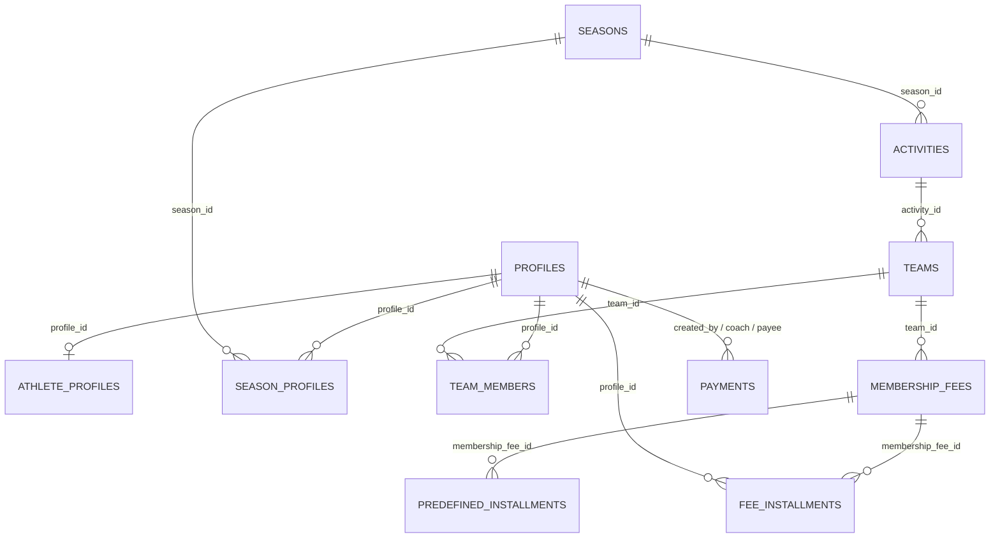

# Audit propedeutico al redesign Admin Quote / Incassi / Atleti

**Data audit:** 14 ottobre 2026  
**Branch:** `review-admin-incassi-atleti`  
**Scope:** sola analisi/documentazione. Nessun redesign, cambio business logic, migration o modifica dati.

## 1. Executive summary

L’area amministrativa oggi distribuisce la gestione economica su tre superfici:

- `/admin/membership-fees`: configurazione dei piani e tab `Atleti` con elenco operativo delle rate;
- `/admin/incassi`: dashboard operativa delle rate, KPI, filtri avanzati e registrazione bulk dei pagamenti;
- `/admin/atleti`: anagrafica, iscrizione stagionale e appartenenza alle squadre, con un dettaglio atleta ancora minimale.

La duplicazione non è soltanto visuale. Le due viste rate usano due Route Handler diversi (`/api/admin/installments` e `/api/admin/incassi/installments`), con filtri, shape, paginazione e semantiche parzialmente diverse. La fonte dati sottostante è però la stessa: `fee_installments`, collegata a `membership_fees` e al profilo tramite `profile_id`.

La vera causa del vincolo “per cambiare quota devo togliere e rimettere la squadra” è il modello attuale: `membership_fees` appartiene a una squadra, ma non esiste una relazione persistente `atleta → piano`. L’assegnazione viene ottenuta creando rate per un profilo quando si esegue l’operazione massiva di assegnazione squadra con `membershipFeeId`, oppure generando rate per tutti i membri della squadra. Il modal di creazione/modifica atleta non accetta né salva un piano.

La squadra e il piano non devono diventare la stessa cosa. Il piano può restare un catalogo compatibile con una squadra; serve però un’assegnazione esplicita, almeno logicamente, con una semantica storica e stagionale chiara. La soluzione minima candidata è introdurre un assignment atleta-piano stagionale/team-scoped, senza riusare `team_members` come fonte finanziaria e senza cancellare automaticamente rate già pagate.

Non è sicuro eliminare oggi una delle due viste senza prima consolidare il backend e coprire i casi storici. La direzione raccomandata è:

1. mantenere `Quote` per la configurazione dei piani;
2. consolidare la gestione operativa delle rate in una sola vista `Incassi`/`Rate`;
3. rendere il `Dettaglio Atleta` il punto athlete-centric per riepilogo, storico e azioni;
4. mantenere le API attuali durante la migrazione, introducendo un contratto/backend unificato prima del cleanup UI.

Rischi principali da risolvere prima del redesign: cancellazione manuale di rate dalla DELETE quota, generazione non idempotente, operazioni non transazionali, assenza di un registro pagamenti entrata distinto dalle rate, e divergenze tra status dichiarati nel codice e vincoli presenti nelle migration.

## 2. Current architecture

### 2.1 Mappa route e componenti

| Area | Route/page | Componente principale | Comportamento |
|---|---|---|---|
| Quote | `/admin/membership-fees` → `src/app/admin/membership-fees/page.tsx` | `MembershipFeesManager` | Tab `Quote`: CRUD piani, rate predefinite, generazione rate; tab `Atleti`: elenco rate e cambio stato |
| Incassi | `/admin/incassi` → `src/app/admin/incassi/page.tsx` | `InstallmentsManager` | KPI, filtri stagione/squadra/piano/stato/date/ricerca, paginazione, bulk payment, drawer atleta |
| Atleti | `/admin/atleti` → `src/app/admin/atleti/page.tsx` | `AthletesManager` | Catalogo atleti, filtri, create/edit, import, bulk operations, assegnazione squadre |
| Modal atleta | usato da `AthletesManager` | `AthleteCreateModal` | Dati anagrafici, stagione, squadre, maglia, tessera, certificato, note; nessun piano quota |
| Dettaglio Atleti | dentro `AthletesManager` | `DetailsDrawer` inline | Nome/email, tessera, certificato, squadre; non carica rate/pagamenti |
| Dettaglio Incassi | dentro `InstallmentsManager` | `incassi/AthleteDetailDrawer` | Fetch diretto client-side di profilo, squadre, rate e pseudo-storico pagamenti |

### 2.2 Flusso Quote

`MembershipFeesManager` carica il contesto con Supabase client-side e il piano con `GET /api/admin/membership-fees?season_id=...`. La GET arricchisce ogni piano con squadra, creatore, `predefined_installments` e `fee_installments` (`src/app/api/admin/membership-fees/route.ts:97-210`).

Le mutation sono nello stesso Route Handler:

- `POST`: crea `membership_fees`, calcola `total_amount` e prova a creare i template in `predefined_installments`;
- `PUT`: aggiorna il piano e cancella/ricrea i template predefiniti;
- `DELETE`: cancella prima template e rate assegnate, poi il piano;
- `PATCH generate_installments`: legge i membri di `fee.team_id` e inserisce una rata per ogni membro/template;
- `PATCH update_installment_status` e `bulk_update_installments`: modifica stato, `paid_at`, account attore e `payment_source`;
- `PATCH update_installment_details`: modifica data/importo di una rata già assegnata.

Il tab `Atleti` usa invece `GET /api/admin/installments`, con filtri `team_id`, `season_id`, `profile_id`, `status`, date e paginazione. Questa è una seconda query applicativa alla stessa tabella.

### 2.3 Flusso Incassi

`InstallmentsManager` usa:

- `GET /api/admin/incassi/kpi?season_id=...` per i conteggi e gli importi;
- `GET /api/admin/incassi/installments?...` per la tabella paginata;
- `POST /api/admin/incassi/payments` per marcare una selezione come pagata.

La dashboard arricchisce le rate con profilo, piano e squadra tramite relazioni Supabase. Il pagamento bulk aggiorna direttamente `fee_installments.status`, `paid_at`, `paid_by_auth_user_id` e `payment_source`. Il campo `paymentMethod` è validato e raccolto dal modal ma non viene persistito: l’endpoint dichiara esplicitamente che non crea record in `payments` perché `payments` rappresenta le uscite (`src/app/api/admin/incassi/payments/route.ts:13-63`).

Il drawer `incassi/AthleteDetailDrawer` legge direttamente dal client Supabase. Il suo `paymentHistory` non è una tabella pagamenti: è una proiezione delle rate con `status = 'paid'`, e assegna sempre il metodo generico `Registrato`.

### 2.4 Flusso Atleti

`AthletesManager` carica l’elenco da `GET /api/admin/athletes?seasonId=...` e carica stagioni, attività e squadre direttamente dal browser. Il Route Handler compone dati da `profiles`, `athlete_profiles`, `season_profiles`, `team_members`, `app_accounts`, `account_roles`, `teams` e `activities`.

Creazione (`POST /api/admin/athletes`):

1. valida stagione e squadre;
2. inserisce `profiles`;
3. inserisce `athlete_profiles`;
4. inserisce `season_profiles`;
5. inserisce eventuali `team_members`;
6. registra audit account lifecycle.

Modifica (`PATCH /api/admin/athletes`):

1. aggiorna email/anagrafica e dati `athlete_profiles`;
2. fa upsert della relazione `season_profiles`;
3. aggiorna domanda di iscrizione;
4. se `team_ids` è presente, elimina tutte le membership dell’atleta nella stagione e le reinserisce.

Rimozione stagione (`DELETE /api/admin/athletes`): elimina le membership `team_members` della stagione e la riga `season_profiles`; non elimina direttamente le `fee_installments`.

Il modal espone la squadra e il numero maglia per relazione, ma non una selezione quota. Lo schema Zod `athleteCreateSchema`/`athleteUpdateSchema` non contiene `membership_fee_id` (`src/lib/validation/profiles.ts:20-45`).

### 2.5 Assegnazione massiva squadra → quota

Il solo flusso UI che collega esplicitamente un piano a un atleta è `TeamAssignmentModal`:

- seleziona una sola squadra per gli atleti;
- chiama `/api/admin/membership-fees/available?team_id=...`;
- permette un `membershipFeeId` solo quando la squadra è singola;
- invia il dato a `POST /api/admin/athletes/bulk`.

`handleTeamAssignment` verifica che il piano appartenga alla squadra, fa upsert in `team_members`, cancella eventuali rate dello stesso `membership_fee_id` per gli atleti selezionati e inserisce le rate dai template (`src/app/api/admin/athletes/bulk/route.ts:112-263`). Non aggiorna né crea una relazione di assegnazione piano-atleta perché tale relazione non esiste.

### 2.6 Autorizzazione e cache

Le Route Handler admin verificano `requireGlobalRole(..., 'admin')`; le query server-side privilegiate usano `createAdminClient`. Le policy finanziarie più recenti derivano il ruolo da `private.has_account_role('admin')` nelle migration `20260807084903`, `20260807085155` e `20260807164000`.

Le tre superfici admin analizzate non usano TanStack Query: usano `useState`, `useEffect`, fetch e/o Supabase client-side. La sincronizzazione dopo mutation è manuale e locale (`loadFees`, `loadFlatInstallments`, `loadInstallments`, `loadKPIData`, `loadAthletes`). Non risultano query key o invalidazioni per questo dominio.

## 3. Current data model

### 3.1 Schema logico reale



La relazione finanziaria implementata non è:

```text
athlete → athlete_fee_assignment → fee → installments → payments
```

È invece:

```text
team → membership_fee → fee_installments ← profile/athlete
```

Quindi l’appartenenza al piano è implicita nella presenza di una o più rate con la coppia `(profile_id, membership_fee_id)`.

### 3.2 Tabelle e vincoli rilevanti

| Tabella | Chiave/relazioni | Vincoli e comportamento rilevante |
|---|---|---|
| `profiles` | PK `id`; oggi disaccoppiata da `auth.users` da migration additiva | Anagrafica condivisa; `email` nullable dopo `20260806180002`; delete a cascata sulle relazioni che puntano al profilo secondo le FK storiche |
| `athlete_profiles` | PK/relazione per `profile_id` | Dati atleta (`membership_number`, certificato, note); il codice lo usa come discriminante atleta |
| `season_profiles` | PK composta `(profile_id, season_id)`; FK verso `profiles` e `seasons` | Iscrizione stagionale, `profile_type`, stato, domanda consegnata; delete dal Route Handler archivia/rimuove l’iscrizione, non le rate |
| `team_members` | PK `id`; unique `(profile_id, team_id)`; FK a profilo/squadra `ON DELETE CASCADE` | Appartenenza squadra e `jersey_number`; non contiene `membership_fee_id` |
| `seasons` | PK `id` | Stagione; le quote vengono filtrate indirettamente via `team → activity → season` |
| `activities` | FK `season_id` | Collega squadre alla stagione |
| `teams` | FK `activity_id`; `code` unique | Non contiene un piano corrente; può avere più `membership_fees` |
| `membership_fees` | PK `id`; FK `team_id ON DELETE CASCADE` | Catalogo/configurazione quota per squadra; importi, mesi, numero rate, `total_amount`, nome/descrizione/creatore usati dal codice |
| `predefined_installments` | FK `membership_fee_id ON DELETE CASCADE`; unique `(membership_fee_id, installment_number)` | Template del piano, non storico di un atleta |
| `fee_installments` | FK `membership_fee_id ON DELETE CASCADE`, `profile_id ON DELETE CASCADE`; unique `(membership_fee_id, profile_id, installment_number)` | Rata materializzata per atleta; stato, importo, scadenza, `paid_at`, attore e origine pagamento |
| `payments` | FK uscite a palestra/attività/squadra/profilo; `type` include `general_cost`, `coach_payment`, `person_payment` | Registro delle uscite, non degli incassi atleta secondo il codice attuale |
| `documents` | FK opzionali a profilo/squadra e template | Supporta il tipo `payment_receipt`, ma non esiste nel modello analizzato una FK diretta a rata o incasso |

### 3.3 Divergenze migration/schema-codice da verificare prima di implementare

La migration master `20251007152643_master_migration_fixed.sql` mostra una versione iniziale di `membership_fees` senza `name`, `description` e `created_by`, e status fee `pending/paid/overdue` nella tabella rate. Il codice corrente usa invece:

- `membership_fees.name`, `description`, `created_by`;
- status `not_due`, `due_soon`, `overdue`, `paid`, e in alcuni tipi `partially_paid`;
- `fee_installments.payment_source` e `paid_by_auth_user_id` aggiunti dalla migration `20260818084159`.

Le migration versionate presenti non contengono tutte le aggiunte implicate dal codice. Questo audit tratta il codice corrente come comportamento applicativo ma segnala la necessità di verificare lo schema reale di staging prima di qualsiasi migration o refactor.

## 4. Current fee lifecycle

### A. Creazione atleta

La creazione crea profilo, profilo atleta, membership stagionale e membership squadra. Non crea una quota e non genera rate (`src/app/api/admin/athletes/route.ts:219-260`). Quindi la quota non deriva automaticamente dalla creazione atleta nel percorso attuale.

L’import atleta ha la stessa responsabilità generale: profilo/dati, `season_profiles` e `team_members`; non emerge un flusso di generazione quote nel file import.

### B. Aggiunta a una squadra

Ci sono due comportamenti distinti:

1. **Create/edit atleta:** salva solo `team_members`; nessuna quota e nessuna rata.
2. **Operazione massiva assign-to-team:** se è presente `membershipFeeId`, salva membership, legge i template e crea `fee_installments` per ogni atleta. Questo è l’unico percorso in cui squadra e scelta quota vengono presentate insieme.

In parallelo, `generate_installments` su una quota legge *tutti* i `team_members` della squadra e inserisce rate per ognuno. Non filtra `role = 'athlete'` nel codice mostrato.

### C. Rimozione squadra o iscrizione stagione

La rimozione in `handleTeamRemoval` elimina solo `team_members`; la rimozione stagione nel Route Handler atleta elimina solo membership e `season_profiles`. Nessuna delle due elimina direttamente `fee_installments`.

Questo significa che le rate già generate possono restare visibili in Quote/Incassi anche senza membership squadra corrente, se il relativo piano e squadra rimangono presenti. È coerente con la conservazione dello storico solo per caso, non per una regola esplicita e documentata.

### D. Riassegnazione alla stessa squadra

`team_members` è idempotente grazie all’upsert su `(profile_id, team_id)`. L’idempotenza non vale però per la generazione rate:

- `generate_installments` usa insert semplice; se il vincolo unique intercetta gli stessi `(fee, profile, installment_number)`, l’operazione può fallire in blocco;
- `handleTeamAssignment` cancella solo le rate dello stesso piano selezionato e poi reinserisce;
- se viene scelto un secondo piano della stessa squadra, le rate del primo piano non vengono eliminate;
- se alcune rate del piano precedente erano pagate, un cambio piano tramite delete/reinsert può lasciarle intatte solo se il vecchio piano non viene cancellato, ma non esiste una semantica di assignment che le chiuda o le colleghi al periodo storico.

**Risposta:** esiste rischio di doppie rate o di più piani contemporaneamente per lo stesso atleta, soprattutto quando si usano piani diversi o si invoca più volte la generazione.

### E. Cambio stagione

La stagione non è una FK diretta in `membership_fees` o `fee_installments`. Viene risolta indirettamente tramite `membership_fees.team_id → teams.activity_id → activities.season_id`. `season_profiles` e `team_members` vengono invece gestiti esplicitamente per stagione nel codice admin.

Il rollover stagionale copia profili/membership squadra, ma non emerge una copia esplicita di `membership_fees`, `predefined_installments` o `fee_installments`. Perciò il comportamento economico tra stagioni deve essere verificato con dati reali e non può essere dedotto dal solo nome “rollover”.

## 5. Duplicate UI audit: Quote > Atleti vs Incassi

| Funzione | Quote > Atleti | Incassi | Backend condiviso? | Valutazione |
|---|---|---|---|---|
| Elenco rate atleta | Sì, tab tabellare/card | Sì, tabella paginata | No: `/api/admin/installments` vs `/api/admin/incassi/installments` | Duplicazione da consolidare |
| Ricerca atleta | Select dipendente dalla squadra | Campo testo nome/cognome/email | No | Incassi è più completo |
| Filtro squadra | Sì, singola select | Sì, multi-select | No | Incassi più ricco |
| Filtro piano | Indiretto tramite quota/squadra | Sì, multi-select | No | Solo Incassi esplicito |
| Filtro stato | Sì | Sì | No | Semantiche da uniformare |
| Filtro date | Sì, da/a | Sì, preset e custom | No | Incassi più ricco |
| Stagione | Sì | Sì | Risoluzione diversa ma indiretta | Da unificare |
| KPI per stato | No, solo dati lista | Sì: conteggi, totale, tasso incasso | Solo endpoint Incassi | Solo Incassi |
| Scadenze | Sì, visibili nelle rate | Sì, preset oggi/7/30/custom | No | Incassi più completo |
| Segna rata pagata | Singola e bulk | Bulk con data/metodo raccolti | Endpoint diversi | Duplicazione critica |
| Annulla pagamento | Sì, cambiando status da paid | Non esposto nella UI Incassi | Solo Quote > Atleti | Feature da preservare e rendere sicura |
| Modifica data/importo rata | Sì | No | Solo `/api/admin/membership-fees` | Feature da preservare |
| Genera rate da piano | Sì | No | Solo `/api/admin/membership-fees` | Configurazione/operazione distinta |
| Modifica/elimina piano | Sì | No | Solo `/api/admin/membership-fees` | Deve restare in Quote |
| Export Excel | Sì | No, bottone CSV non implementato | Solo Quote implementato | Da censire prima del cleanup |
| Export CSV | Bottone Atleti in `/admin/atleti`, non implementato nel manager | Bottone presente ma senza handler | Nessuno | Non considerare feature funzionante |
| Dettaglio atleta | No, dettaglio minimale inline | Sì, drawer finanziario | Query client-side distinta | Da convergere nel Dettaglio 360° |
| Storico pagamenti | Mostra `paid_at` della rata | Proietta rate pagate come storico | Nessuna tabella entrate condivisa | Modello da chiarire |
| Pagamenti parziali | Status tipo supportato dalla UI in parte | KPI/status supportato nominalmente | Schema/logic non coerenti | Non implementato in modo affidabile |
| Ricevute | Nessun link rata-ricevuta | Nessun link rata-ricevuta | `documents` generico | Gap di dominio |

### Feature solo in Incassi

- KPI per status, importo totale, totale incassato e tasso;
- ricerca testuale atleta;
- multi-filtro squadra/piano/stato;
- preset temporali;
- paginazione;
- bulk payment con data e metodo nel client;
- raggruppamento tabella per atleta/piano;
- drawer finanziario atleta.

### Feature solo in Quote > Atleti

- cambio stato singolo con possibilità di riportare una rata non pagata;
- modifica manuale data/importo rata;
- vista collegata al dettaglio del piano;
- generazione rate dal template;
- export Excel del catalogo quote.

### È safe eliminare una delle due viste?

**Non ancora.** È ragionevole eliminare in futuro il tab `Quote > Atleti` come vista operativa duplicata, ma solo dopo aver portato in `Incassi`:

- modifica controllata di data/importo rata;
- annullamento/rettifica pagamento con audit;
- eventuale export realmente funzionante;
- accesso al piano/template e generazione rate, se si decide che la generazione appartiene all’operatività;
- filtri equivalenti e storico.

La configurazione dei piani deve rimanere in `Quote`. Le API `/api/admin/membership-fees` non possono essere rimosse insieme alla UI: contengono CRUD piano, template, generazione e mutate rate.

## 6. Athlete fee assignment audit

### Sorgente attuale dell’assegnazione

Non esiste una sorgente unica esplicita. La situazione è:

- **catalogo piano:** `membership_fees.team_id`;
- **candidati del piano:** membri di `team_members` della squadra;
- **assegnazione materializzata:** una o più righe `fee_installments(profile_id, membership_fee_id, ...)`;
- **scelta UI esplicita:** solo `TeamAssignmentModal` → `membershipFeeId`;
- **creazione/modifica atleta:** nessuna scelta quota;
- **regola automatica:** `generate_installments` può generare per tutti i membri della squadra.

Quindi la descrizione “devo togliere e riassegnare la squadra” è solo parzialmente esatta: il codice non rende la quota una proprietà di `team_members`, ma la UI accoppia assegnazione squadra e generazione rate e non offre una mutation “cambia piano” autonoma. Il workaround nasce dall’assenza di un assignment e dal fatto che l’unico selettore quota visibile è nel modal di assegnazione squadra.

### Modello target minimo

Prima scelta da valutare: una relazione esplicita stagionale e team-scoped, ad esempio `athlete_fee_assignments`, con almeno:

```text
id
profile_id
team_id
membership_fee_id
season_id o derivazione vincolata
valid_from
valid_until / ended_at
status
created_by / ended_by
```

Non è sufficiente aggiungere solo `membership_fee_id` a `team_members` se si vuole preservare lo storico di cambio piano: `team_members` ha già semantica di membership corrente, unique per profilo/squadra e cascade delete. Una colonna singola perderebbe i periodi precedenti e renderebbe ambiguo il caso di più stagioni.

La relazione deve vincolare `membership_fee_id` alla stessa squadra (`team_id`) e stagione del contesto. Se lo schema reale dimostrasse che un fee è già versionato in modo equivalente, si può riusare quella struttura; il codice/migration ispezionati non lo dimostrano.

### Regole sicure per cambio piano

| Caso | Semantica raccomandata |
|---|---|
| Nessuna rata pagata | Chiudere il vecchio assignment; annullare/ritirare solo rate future non pagate; creare le rate del nuovo piano in una transazione; mai cancellare silenziosamente righe già esposte in report senza audit |
| Alcune rate pagate | Conservare rate e `paid_at` del vecchio piano; chiudere il vecchio assignment alla data di cambio; creare solo il calendario futuro del nuovo piano; nessun ricalcolo retroattivo del pagato |
| Rata scaduta non pagata | Non eliminarla automaticamente: resta un debito storico del vecchio piano oppure deve essere marcata `superseded/waived` con motivo e attore, secondo decisione contabile esplicita |
| Pagamento parziale | Il modello attuale non ha importo pagato distinto da `amount`; prima di supportarlo serve una decisione e un ledger/colonna dedicata. Non usare `status = partially_paid` senza importo residuo persistito |
| Cambio retroattivo | Vietarlo di default; consentirlo solo con permesso/audit esplicito e data di efficacia, senza riscrivere storico pagato |

La modifica del piano deve essere una mutation server-side atomica che verifica admin, atleta, stagione, appartenenza squadra, compatibilità piano e stato delle rate. Non deve essere composta da delete/insert client-side separati.

## 7. Historical data safety

### Regole non negoziabili

- non cancellare rate pagate;
- non sovrascrivere importo, scadenza o piano di una rata pagata per reinterpretare il passato;
- non cancellare o sostituire un record di storico per cambiare il piano corrente;
- non usare `membership_fees` mutable come snapshot storico di una rata già emessa;
- conservare attore, data, origine e motivo di rettifica;
- distinguere incasso atleta da uscita societaria in `payments`;
- non presentare `documents.type = payment_receipt` come ricevuta di una rata finché non esiste un collegamento verificabile;
- impedire che una cancellazione squadra o stagione renda irrintracciabili dati economici.

### Problemi attuali

1. `DELETE /api/admin/membership-fees` elimina esplicitamente tutte le `fee_installments` del piano prima di eliminare il piano (`route.ts:308-337`), quindi può distruggere storico pagato.
2. Le FK storiche `ON DELETE CASCADE` da `membership_fees` a `fee_installments` e da `profiles` a `fee_installments` amplificano il rischio se si cancella un piano o un profilo.
3. Il cambio di `membership_fees` aggiorna il catalogo e ricrea i template, ma non versiona il significato delle rate già emesse.
4. Le operazioni create/edit atleta e bulk non sono transazioni DB uniche; alcune compensano manualmente, altre ignorano errori secondari.
5. Il metodo di pagamento incasso viene perso; la cronologia è ricostruita dalle rate pagate.

## 8. Recommended target architecture

### Separazione delle responsabilità

```text
Quote
└─ catalogo/configurazione piani e template

Incassi / Rate
└─ rate emesse, scadenze, rettifiche, incassi e reporting operativo

Atleti
└─ anagrafica, stagione, squadre e accesso al Dettaglio Atleta

Dettaglio Atleta
└─ vista 360° aggregata, con azioni che delegano a mutation server-side
```

Il contratto futuro dovrebbe avere un loader/server service condiviso per costruire una riga finanziaria coerente. Le UI non dovrebbero interrogare direttamente Supabase per lo stesso dominio con shape diverse.

### Source of truth proposta

- piano: catalogo `membership_fees` versionato o reso immutabile quando usato;
- assegnazione: relazione esplicita atleta-piano per squadra/stagione;
- rata: record emesso immutabile nei dati economici essenziali, con stato/rettifica auditabile;
- incasso: ledger o record di pagamento entrata collegato a una o più rate, con importo, data, metodo, attore, ricevuta e audit;
- reporting: query unica sui record finanziari, non conteggi ricostruiti in più endpoint.

### Cache/UI

Il dominio admin non è migrato a TanStack Query. Prima di introdurlo, definire query key account-aware per admin e stagione/contesto, invalidazioni mirate dopo mutation e una distinzione netta tra cache server state e stato visuale. Non usare cache client come autorizzazione.

## 9. Target Information Architecture: Dettaglio Atleta 360°

Il drawer minimale inline di `AthletesManager` e il drawer finanziario di `Incassi` dovrebbero confluire in una sola vista amministrativa, mantenendo lazy loading per le sezioni pesanti.

### Sezioni

1. **Identità:** nome, cognome, email, telefono, nascita, stato account.
2. **Tesseramento/documenti:** numero tessera, stato/scadenza certificato, domanda iscrizione, documenti esistenti e ricevute solo se realmente collegate.
3. **Stagioni e squadre:** stagione, squadra, numero maglia, stato membership.
4. **Quote assegnate:** per ogni squadra/stagione, piano corrente, periodo di validità, totale, rate, pagato, residuo, prossima rata, scaduto.
5. **Rate:** elenco con stato, importo, scadenza, piano/assignment e azioni autorizzate.
6. **Incassi/storico:** data, importo, metodo, attore, fonte, ricevuta, rettifiche.
7. **Account/accesso:** account collegato/non collegato e ruoli rilevanti, senza esporre segreti.
8. **Note:** note anagrafiche già esistenti, senza inventare nuovi campi.

### Azioni

- modifica anagrafica;
- modifica squadre e numero maglia;
- assegna/cambia piano con data efficacia e preview dell’impatto;
- segna rata pagata o rettifica con conferma/audit;
- apri configurazione piano;
- apri documenti/ricevute collegati;
- operazioni bulk solo dove il contratto le rende sicure.

Il dettaglio non deve diventare una seconda fonte di verità: visualizza e invoca mutation condivise.

## 10. Security and regression risks

### HIGH

- **Perdita storico:** DELETE quota elimina rate, anche pagate.
- **Doppie rate:** generazione insert non idempotente e più piani possibili per lo stesso atleta.
- **Orphan/semi-orphan economici:** rimozione squadra/season non definisce il ciclo di vita delle rate.
- **Non atomicità:** create/edit atleta, assegnazione squadra e rate sono più scritture separate.
- **Reporting incoerente:** status e filtri sono calcolati da endpoint diversi; `partially_paid` è presente nella UI ma non rappresentato come importo parziale persistito.
- **Incasso incompleto:** `paymentMethod` non è persistito e `payments` non è un registro entrate.
- **Schema drift:** migration master e codice corrente non descrivono lo stesso contratto.

### MEDIUM

- `generate_installments` seleziona i membri squadra senza filtro esplicito `role = athlete`.
- Filtraggio stagione indiretto e duplicato in JavaScript in più endpoint.
- Dettagli atleta caricati con query client-side non condivise e senza contratto comune.
- Modifica piano ricrea i template ma non avvisa dell’impatto sulle rate già emesse.
- Errori di template/generazione talvolta vengono loggati e ignorati lasciando operazioni parziali.
- Nessun collegamento verificabile tra ricevuta documentale e rata.

### LOW

- Export CSV presenti come affordance senza implementazione completa.
- Tipi `any` e status duplicati tra componenti admin.
- Query N+1 nell’arricchimento di `membership-fees`.
- Mancanza di query key/invalidation condivise rende più facile mostrare dati non aggiornati tra tab/pagine.

## 11. Test gaps

### Copertura esistente

Sono presenti test per validation quote, Route Handler atleti/bulk, KPI Incassi e lista Incassi (`src/lib/validation/membershipFees.test.ts`, `src/app/api/admin/athletes/route.test.ts`, `src/app/api/admin/athletes/bulk/route.test.ts`, `src/app/api/admin/incassi/kpi/route.test.ts`, `src/app/api/admin/incassi/installments/route.test.ts`). Sono presenti inoltre test atleta lato utente, ma non una suite completa del lifecycle admin quota-atleta.

### Test obbligatori prima del redesign

1. Create atleta con zero/una/più squadre e nessuna rata generata automaticamente.
2. Assign team con piano: crea esattamente una serie di rate e rifiuta piano di altra squadra/stagione.
3. Ripetizione dello stesso assign/generate: comportamento idempotente e nessuna duplicazione.
4. Assegnazione di un secondo piano: rifiuto o chiusura esplicita del precedente, mai coesistenza implicita.
5. Rimozione squadra e rimozione stagione: comportamento documentato delle rate future, pagate e scadute.
6. Cambio squadra in PATCH atleta: nessuna cancellazione accidentale delle rate.
7. DELETE quota con rate pagate: deve essere rifiutato o archiviato, mai cancellare storico.
8. Cambio template piano: rate già emesse immutate.
9. Generazione concorrente: transazione/idempotenza e gestione del vincolo unique.
10. Stato `partially_paid`: contratto esplicito con importo pagato/residuo, oppure rimozione dello status dalle UI.
11. Bulk payment: atomicità, data, metodo persistito, attore, retry senza duplicazioni.
12. Rate pagate da Quote e Incassi: stesso risultato, stesso status, stessa possibilità di rettifica.
13. KPI vs lista: stessi filtri stagione/piano/squadra e stessi totali.
14. Storico/ricevuta: relazione corretta e autorizzazione admin.
15. Season isolation: piano/rate di una stagione non contaminano l’altra.
16. RLS/account role: admin autorizzato, non-admin negato, nessun uso del ruolo legacy come fonte principale.
17. Athlete Detail: dati anagrafici, squadre, quote, rate, incassi e documenti coerenti.
18. Test E2E del flusso `crea atleta → assegna piano → registra pagamento → cambia piano`.

## 12. Implementation plan futuro

Il seguente ordine corregge la sequenza indicativa del goal mettendo prima sicurezza e contratto dati.

### Goal 1 — Baseline schema e safety tests

Verificare schema staging read-only e aggiungere test di regressione per delete, duplicate generation, season isolation e stato pagato. Nessuna UI redesign.

### Goal 2 — Contratto finanziario e assignment design

Decidere, sulla base dello schema reale, se introdurre `athlete_fee_assignment`/equivalente o riusare una struttura esistente. Definire stati, data efficacia, vincoli e transazioni. Solo design/migration review, senza rollout dati finché i test non passano.

### Goal 3 — Mutation sicure di assegnazione/cambio piano

Implementare servizio server-side atomico per assegnazione iniziale, cambio piano, chiusura rate future e conservazione storico. Mantenere le API legacy durante la transizione.

### Goal 4 — Modal atleta con scelta piano

Estendere schema, create/edit e UI per scegliere piano compatibile per squadra/stagione. Separare chiaramente membership squadra e assignment finanziario. Coprire preview e conferma dell’impatto.

### Goal 5 — Contratto operativo unico Rate/Incassi

Unificare loader, filtri, status, KPI, paginazione, rettifiche e bulk payment. Portare nel nuovo contratto le sole funzioni realmente esistenti; non eliminare ancora route/component.

### Goal 6 — Dettaglio Atleta 360°

Comporre il nuovo dettaglio usando i contratti condivisi, con lazy loading e azioni che richiamano mutation centrali. Verificare account/season isolation.

### Goal 7 — Consolidamento UI e cleanup controllato

Mantenere `Quote` per configurazione; rimuovere solo il tab operativo duplicato dopo parity test con Incassi. Conservare API necessarie e redirect/deep link finché non sono migrati.

### Goal 8 — Final regression audit

Suite completa, E2E, accessibilità, staging read-only, verifica report/bilancio/documenti e review di RLS, audit log e rollback.

## 13. Risposte alle acceptance questions

1. **Perché oggi una quota viene assegnata?** Non alla creazione atleta; quando l’admin seleziona `membershipFeeId` nell’assegnazione massiva squadra o genera le rate dal piano.
2. **Quale relazione la determina?** Il piano è legato a `team_id`; l’atleta è collegato materialmente dalle `fee_installments.profile_id`.
3. **Cosa succede rimuovendo la squadra?** Si elimina `team_members`; le rate non vengono eliminate dal Route Handler di rimozione.
4. **Cosa succede riaggiungendo?** `team_members` usa upsert; assegnando lo stesso piano le rate vengono cancellate e ricreate; generando dal piano si può ottenere errore di duplicate; scegliendo un piano diverso possono coesistere rate vecchie e nuove.
5. **Doppie rate?** Sì, rischio concreto per generazione ripetuta/piani diversi; il vincolo unique blocca solo la stessa identica tripla.
6. **Cambio quota senza squadra?** Serve una mutation autonoma basata su assignment esplicito e compatibilità team/stagione.
7. **Rate pagate dopo cambio?** Devono restare immutate nel vecchio piano/assignment; il nuovo piano genera solo il futuro.
8. **Solo Incassi?** KPI, ricerca testuale, multi-filtri, preset date, paginazione, bulk con data/metodo, grouping e drawer finanziario.
9. **Solo Quote > Atleti?** Modifica rata, rettifica status, generazione, export Excel e gestione collegata al piano.
10. **Quale vista eliminare?** In prospettiva il tab operativo `Quote > Atleti`, non la configurazione `Quote`; solo dopo parity e safety gate.
11. **API da mantenere?** CRUD/template/generazione e mutation rata di `/api/admin/membership-fees`, oltre ai contratti Incassi finché il nuovo service non li sostituisce.
12. **Modifiche modal atleta?** Aggiungere piano compatibile per squadra/stagione a schema, create/edit e mutation atomica; non mettere l’ID piano in `team_members` senza storico.
13. **Dettaglio 360?** Identità, documenti, stagioni/squadre, quote assignment, rate, incassi/ricevute, account, note e azioni sicure.
14. **Test prima del redesign?** Delete safety, idempotenza, cambio piano, pagamenti, stagioni, RLS, parity Quote/Incassi e E2E del lifecycle.

## 14. Verifica staging

La verifica reale read-only dello staging è stata completata il 2026-10-14 sul progetto `csromawebapp-staging` (`kibtvkuiedoxgppnnxkf`). Il report aggregato e la fixture di regressione sono in:

- `docs/admin-athlete-fees-staging-safety-report-2026-10-14.md`;
- `tests/fixtures/admin-financial-staging-baseline-2026-10-14.json`;
- `tests/admin-financial-safety-baseline.test.ts`.

Risultati sintetici: 70 migration registrate, RLS attiva sulle tabelle analizzate, 4 piani quota, 12 rate emesse, 6 pagate, nessuna anomalia referenziale o di stato osservata. Restano da coprire con test mutativi autorizzati la preservazione delle rate pagate durante delete/edit, l’assegnazione piano-team e l’atomicità ricevuta-documento.

## 15. GOAL COMPLETED

**File analizzati:** route/page admin, manager e modal Quote/Incassi/Atleti, Route Handler quote/rate/incassi/atleti/bulk/import, validation Zod, server contract atleta, migration finanziarie/account/stagioni e test mirati.

**Tabelle analizzate:** `profiles`, `athlete_profiles`, `season_profiles`, `seasons`, `activities`, `teams`, `team_members`, `membership_fees`, `predefined_installments`, `fee_installments`, `payments`, `documents`, oltre a `app_accounts`/`account_roles` per autorizzazione.

**File creati/modificati:** aggiornato questo audit; creati il report staging, la fixture aggregata e la suite `tests/admin-financial-safety-baseline.test.ts`; nessun file applicativo, migration o dato di staging modificato.

**Test eseguiti:** query Supabase staging esclusivamente read-only su schema, migration, policy, constraint, indici, baseline e anomalie; suite Jest della baseline aggiunta e da eseguire nel controllo finale.

**Conclusione tecnica:** la quota non è attualmente un attributo esplicito dell’atleta né della membership squadra; è materializzata dalle rate. Il redesign deve introdurre un assignment storico e una mutation atomica prima di offrire il cambio piano dal modal atleta o eliminare il tab operativo duplicato.

**Principali blocker:** schema migration/codice non completamente allineati; assenza di ledger incassi/ricevute collegato alle rate; delete quota distruttiva; generazione non idempotente; status parziali non supportati end-to-end.

**Prossimo goal proposto:** Goal 1 — introdurre un assignment storico piano-atleta e rendere sicure/idempotenti le mutation di generazione e cambio quota, dopo aver definito test mutativi isolati.

## 16. Implementation status — hotfix rimozione quota da singolo atleta

È stato implementato un hotfix amministrativo circoscritto per rimuovere le
rate di una singola coppia `profile_id + membership_fee_id`, senza modificare
membership di squadra, piano globale, template o rate di altri atleti.

La nuova mutation verifica tutte le rate prima della cancellazione e blocca
l’operazione in presenza di `paid`, `partially_paid`, `paid_at`, attore di
pagamento o origine di pagamento. L’azione è disponibile in `Quote > Atleti`
con conferma esplicita e usa l’audit esistente (`repair_required` con
`details.action = athlete_fee_removed`).

Questo hotfix non introduce `athlete_fee_assignments`, non risolve il modello
definitivo di assegnazione/cambio piano e non modifica rate pagate. Il futuro
assignment storico resta necessario.
